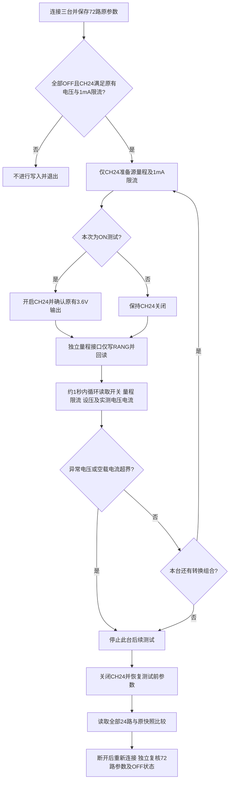

# 模拟器仅切量程空载实测（2026-10-24）

本报告主体记录同日较早的“仅写量程”版本。用户随后要求切LOW时自动先设置1mA；该次更新和新增硬件验证见文末补充，主体原始记录保留。

源码的独立量程操作仅发送量程写指令；三台设备完成36次转换，其中18次保持输出ON，设备自身回读未显示输出关闭或电压降至零。但是，三台在输出OFF时从HIGH切AUTO，均出现限流回读由1mA变为1000mA的情况。因此不能保证只写量程后设备其他设置一定不变，也不能把此次结果描述为36次全部参数不变。

## 测试范围与条件

- 用户确认三台全部空载，地址192.168.1.110～112，TCP端口7000。
- 三台身份回读均为`NGI,N83624,0,H2.00S1.42`。
- 每台仅操作CH24，其余23路只读取核对；测试前72路均为OFF，原有设定为3.6V、LOW、1mA限流。
- 每台分别在OFF及ON状态，覆盖HIGH→LOW、LOW→HIGH、HIGH→AUTO、AUTO→LOW、LOW→AUTO、AUTO→HIGH，共12次；三台共36次，其中18次输出ON。
- 通过当前源码`control_simulator(..., 'range', [24], target)`调用独立量程接口。未使用打包EXE执行本次测试，未改配方。
- 原始数据：[汇总及每次采样](../../logs/simulator_range_only_20261024_173431/summary.json)、[测试前快照](../../logs/simulator_range_only_20261024_173431/preflight.json)、[恢复后独立复核](../../logs/simulator_range_only_20261024_173431/final_verified.json)。日志时间记录为北京时间。

## 测试方法



准备阶段会显式关闭CH24、设置源量程、设置1mA限流，并按测试组合开启输出。这些操作与被测的“仅切量程”阶段分开记录。量程阶段共36条写指令，全部是`SOUR24:RANG 0/2/3`；该阶段没有`OUTP`、`OUTCURR`或`VOLT`写指令。观察阶段只查询。

每次转换后读取约20组样本，观察持续约1秒。异常停止条件为设备回读空载电流绝对值超过2mA，或电压超过原有设定0.2V。本次没有触发上述停止条件。

## 实测结果

| 地址 | 转换次数 | ON转换次数 | ON状态设备电压回读范围 | 限流变化 | 恢复核对 |
| --- | ---: | ---: | --- | --- | --- |
| 192.168.1.110 | 12 | 6 | 3.59998～3.60021V | OFF，HIGH→AUTO：1→1000mA | 24路参数一致，全部OFF |
| 192.168.1.111 | 12 | 6 | 3.59996～3.60663V | OFF，HIGH→AUTO：1→1000mA | 24路参数一致，全部OFF |
| 192.168.1.112 | 12 | 6 | 3.60008～3.60010V | OFF，HIGH→AUTO：1→1000mA | 24路参数一致，全部OFF |

- 36次目标量程设定回读均正确，开关状态和电压设定均保持原值。
- 18次ON转换共360组设备电压回读样本，均在原有3.6V的±0.05V内。
- 33次限流回读保持1mA。三次例外均为OFF状态HIGH→AUTO，每台21组后续样本全部回读为1000mA，持续约1秒；不是仅一帧变化。ON状态下相同转换的限流回读保持1mA。
- 所有测试完成后恢复原有LOW、1mA及3.6V设定。重新连接核对全部72路，参数与测试前一致且全部OFF。

## 限流变化的指令证据

以192.168.1.110为例，原始记录中的关键顺序如下。`OUTCURR`协议值单位为mA，驱动快照换算为A保存。

```text
SOUR24:OUTCURR?   -> 1
SOUR24:RANG?      -> 0
SOUR24:RANG 3
SOUR24:RANG?      -> 3
OUTP24:ONOFF?     -> 0
SOUR24:RANG?      -> 3
SOUR24:OUTCURR?   -> 1000
SOUR24:VOLT?      -> 3.6
MEAS24:VOLT?      -> 0
```

三台均出现相同行为。测试连接在上述量程写入和观察期间没有发送限流写指令，结果表明量程操作伴随设备限流回读变化；仅凭此数据不能判定固件内部实现或1000mA限流的实际带载效果。

各台完整SCPI记录：[110](../../logs/simulator_range_only_20261024_173431/192.168.1.110_scpi.jsonl)、[111](../../logs/simulator_range_only_20261024_173431/192.168.1.111_scpi.jsonl)、[112](../../logs/simulator_range_only_20261024_173431/192.168.1.112_scpi.jsonl)。准备、量程操作、观察及恢复分别以`setup`、`range_only`、`observe`、`restore`标识。

## 证据边界与使用建议

本次用设备自身查询观察输出，没有接示波器或外部电压表。ON测试中各台最早首组样本在动作开始约45～47ms后完成，采样间隔最高约63ms，设备内部测量刷新周期也未确认；无法据此排除更短的瞬时跌落。量程设定回读匹配，也不能证明实际电流测量范围或精度已立即切换；这需要已知电流负载或外部标准仪器验证。

独立量程接口保持用户要求的仅写量程边界，不自动补写限流或重新开关输出。使用AUTO仍需核对限流，尤其是OFF状态HIGH切AUTO后准备开启输出时。实际被测物要求连续供电时，应在供电前完成量程及限流配置；此次空载结果不能替代带载验收。

## 交付记录

- 测试脚本：[test_simulator_range_only_hardware.py](../../tools/test_simulator_range_only_hardware.py)，固定这三个地址及CH24，运行需显式传入`--execute --unloaded --output`。
- 本次新增实测报告并更新[独立量程流程说明](../flowcharts/simulator_range_only.md)，没有追加修改运行控制逻辑。
- 离线关联回归此前已通过153项及172个子测试；这是与本次硬件实测分开的验证记录。
- 本次未打包EXE、未提交或推送。

## 后续更新：切LOW自动先设置1mA

用户随后明确要求，切LOW时自动先将限流设为1mA。当前源码已改为：所选通道限流不是1mA时，先设置并回读确认1mA，再切LOW；HIGH/AUTO仍不主动修改限流。独立工步和调试页共用此逻辑，仍不主动开关输出或修改电压。

三台空载设备各仅使用CH24，在原有3.6V下，分别覆盖OFF/ON与HIGH/AUTO四种组合，从100mA限流执行切LOW，共12次全部通过。操作阶段每次仅按顺序写入`SOUR24:OUTCURR 1`、`SOUR24:RANG 2`；约1秒后续观察中，量程为LOW，限流为1mA，开关状态和电压设定均保持不变。ON测试120组设备电压回读为3.59996～3.60020V；瞬态与量程实际精度的证据边界同上。

测后恢复原参数，重新连接核对72路均为OFF，且量程、限流及电压设定与测试前一致。离线关联回归161项及172个子测试通过；本次未打包EXE、未提交或推送。

新增证据：[自动限流测试汇总](../../logs/simulator_low_auto_limit_20261024_175454/summary.json)、[独立恢复复核](../../logs/simulator_low_auto_limit_20261024_175454/final_verified.json)、[复现脚本](../../logs/simulator_low_auto_limit_20261024_175454/probe.py)。
