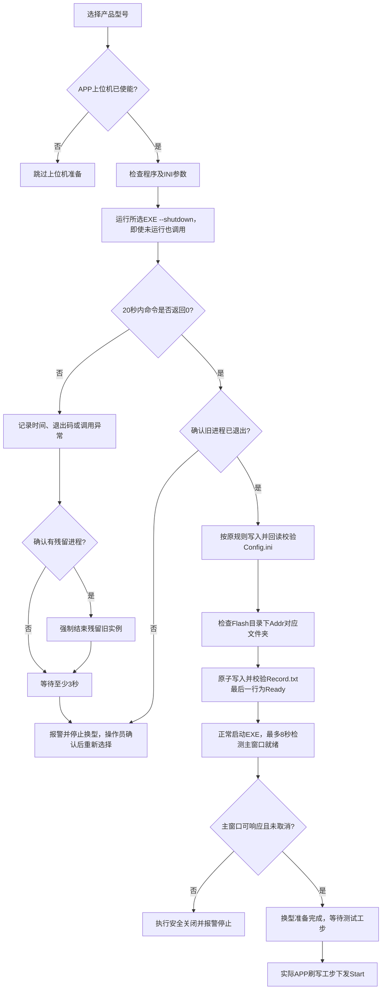

# 换型时安全关闭BMS刷写上位机

依据：`D:\GIT\BMS_Gen_V1.0(26.10.24)\docs\BMS刷写上位机交互流程.md`。

启用APP上位机参数时，选择产品型号按以下流程准备；未使能配方保持原有跳过行为。同一型号连续测试不重复准备或重启，实际刷写工步再下发Start。

- 安全关闭命令以独立参数列表运行，工作目录为所选EXE目录，隐藏命令窗口；沿用外部进程环境和DLL搜索路径隔离。
- 返回2、3、其他非零码或20秒超时均失败；只有失败后确认残留进程时才使用taskkill兜底，且不会自动继续写配置或重启。
- 安全退出成功并确认旧进程消失后立即写配置；写入并回读校验INI与Ready成功后立即启动，不再附加两次500ms延时。Ready文件短暂占用时每100ms重试，最多10次。文件目录相对所选EXE计算，Addr必须指向Flash目录内的文件夹。
- 8秒仅是启动就绪超时上限：检测新进程的Windows输入空闲状态，并确认该进程具有可见、使能、无所有者且能响应WM_NULL的主窗口后立即返回；隐藏窗口、错误对话框、无响应窗口和单纯进程存活均不算就绪。此判断确认GUI就绪，不冒充协议中未提供的刷写硬件初始化完成应答。启动失败、超时或取消时仍执行安全关闭。

Windows探测依据：[WaitForInputIdle](https://learn.microsoft.com/en-us/windows/win32/api/winuser/nf-winuser-waitforinputidle)和[SendMessageTimeoutW](https://learn.microsoft.com/en-us/windows/win32/api/winuser/nf-winuser-sendmessagetimeoutw)。输入空闲标记只首次生效，因此还要探测当前主窗口是否可响应。

## 此前安全关闭改造验证（2026-10-24）

- 修改前原有进程、换型及参数测试81项、测试页选择9项通过；修改后相关测试105项及测试页选择9项通过，均正常退出。
- 新增验证覆盖：未运行仍调用shutdown、20秒命令等待、返回2/3/其他非零码、超时仅先结束命令进程、确认残留后才强制清理、无残留不强杀、冷却3秒、返回0但残留时阻断、取消、8秒进程存活观察、初始化中退出、启动失败安全清理、打包环境DLL路径恢复。
- 换型链保留真实临时INI/Record文件读写，验证安全退出前文件不变、失败不写入或重启、正常先写配置再写Ready、Flash目录无效阻断、文件占用重试及临时文件清理。进程创建/结束均使用替身，没有关闭或启动真实上位机。
- 编译检查及允许Windows CRLF行尾的差异空白检查通过。
- 未修改实际配方或现场配置，未联调真实BMS_General、未打包EXE、未提交或推送。部署时须使用实现`--shutdown`接口的新版刷写程序。

## 本次取消固定延时验证（2026-10-24）

- 进程启动23项、窗口条件15项、安全关闭17项、换型45项、APP参数24项、CAN复用14项通过；测试页选择9项分进程通过，共147项。语法检查及允许Windows CRLF行尾的差异检查通过。
- 测试页选择9项组合运行曾在Qt事件过滤器/垃圾回收期间出现native abort，该轮未计入通过；单项子进程均正常退出。随后已继续定位并修复关闭页面的生命周期问题，原清理方式9项组合连续5轮、扩大162项组合连续3轮正常通过，详见[Qt崩溃修复记录](../audits/测试页组合运行Qt原生崩溃修复_20261024.md)。
- Windows独立C#测试程序实测：普通主窗口约0.311秒就绪，模拟自动登录后显示主窗口约0.358秒就绪；无窗口在约0.604秒触发0.6秒超时，无响应窗口在约0.804秒触发0.8秒超时，立即退出在约0.054秒被识别。测试程序在Load事件中保留250ms初始化工作，确认调用方不会在初始化结束前返回。结果：`scratch/host_readiness_20261024/results.json`。
- 正常关闭继续调用`--shutdown`并确认旧进程消失；仅异常且确认残留时强制清理，异常冷却3秒保持不变。此次未修改实际配方、现场配置或外部上位机源码，未联调真实BMS_General或重新打包EXE。
