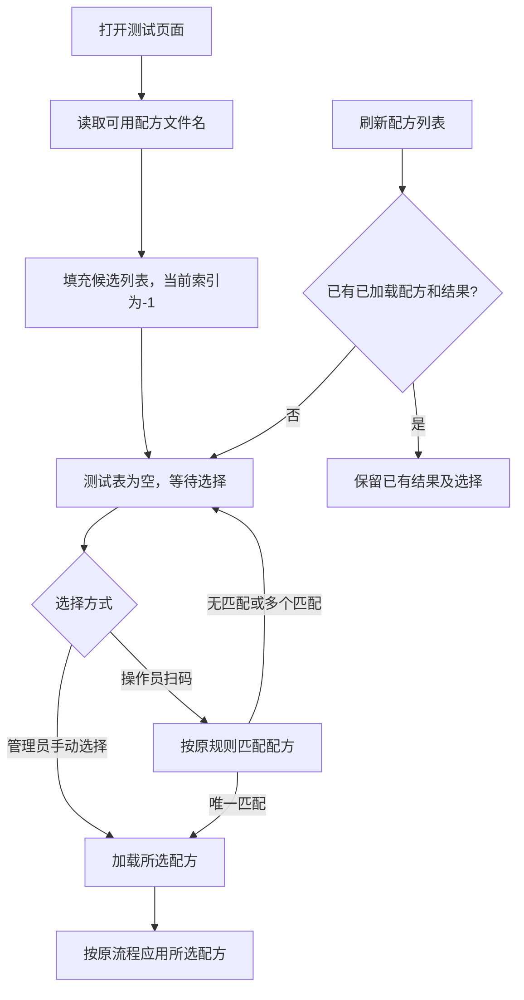
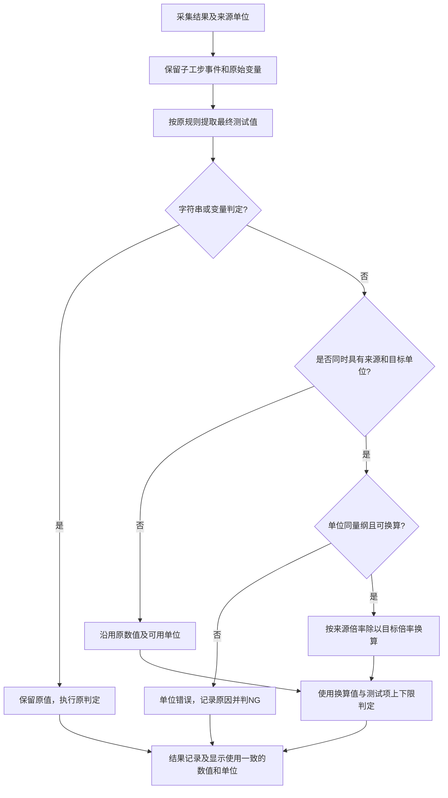

# 启动等待选择配方与测试项单位

## 启动选择规则

启动时只枚举可选择的配方，不加载默认或首个配方。管理员和操作员均以空测试表、下拉框未选择状态启动；后续手动选择和扫码匹配沿用现有权限。刷新可选列表不自动选首项，已完成测试返回页面仍保留已有结果。

## 单位换算

测试项单位决定最终结果单位，采用标准比例：1mA＝1000uA，0.1mA＝100uA。最终结果先换算，再按测试项所填单位的上下限判定并记录；小数位数仍只影响显示，不参与原始精度判定。

支持电流、电压、电阻、频率、时间的常用倍率及同义单位（u/µ/μ、Ω/ohm、℃/°C/C、%/%RH）。仪表和DBC读数保留来源单位；子工步事件、变量与原始输出保持来源值，最终测试项使用换算值。旧式读取变量路径也保留单位并进入统一结果收集。

父项及可换算的对应子项在显示时均先换算、后截取小数；监控窗口的实时和缓存显示沿用同一规则。不同量纲的诊断子项保持其来源单位。用户图中的0.0336643mA在目标uA下为33.6643uA：保留两位显示33.66uA，保留零位显示33uA，未指定小数位显示33.6643uA；判定使用完整换算值。

没有来源单位的纯数值沿用原处理，不推测单位；测试项单位为空或NULL时沿用来源单位。字符串和变量判定不做单位换算。明确来源与目标量纲不一致或不支持换算时，输出具体错误并判NG，不把未换算数值贴上目标单位。

## 验证（2026-10-24）

- 分组运行相关测试共261项及172个子测试通过，均正常退出。包括启动空选择、手动/扫码选择、结果保留、模拟电池批量电流变量、DBC单读/快照、读取变量、单位倍率、量纲错误、上下限、实时/缓存显示和结果记录。
- 使用实际数据库写入和XLS生成流程，检查报告渲染输入为123.456uA、两位显示123.45、单位uA，并生成有效OLE文件头的XLS文件。未在Excel内打开验收。
- 实际应用样式及字体离屏预览确认启动表为空且下拉当前索引为-1；示例父项/子项显示33.66uA，电压例为3200.0mV。预览位于 `scratch/unit_display_check/startup_empty.png` 和 `scratch/unit_display_check/item_units.png`，示例数据不涉及真实硬件。
- 编译检查及允许Windows CRLF行尾的差异空白检查通过。
- 回归限制：部分Qt异步选择测试组合运行在修改前后均出现native abort/垃圾回收相关崩溃，分文件运行均通过；不将组合运行视为通过。`tests/test_result_decimal_places.py` 因当前环境缺少xlrd无法收集，未安装新依赖；本次专项已独立覆盖单位换算后的显示截位、完整精度判定、数据库及XLS写入，不能称为全量回归通过。
- 未连接真实仪表、未进行现场或EXE验收、未打包、未提交或推送。
