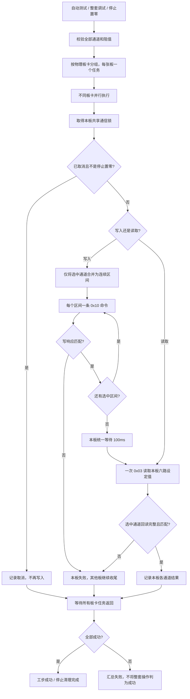

# 电阻板跨板并行与单板批量控制

适用范围：六通道电阻板的自动测试、整套独立调试和停止置零。配方格式、全局通道映射和阻值判定不变。

- 全选单板六路：`0x10` 从 `0x0000` 写 12 个寄存器，再用 `0x03` 读取 12 个寄存器确认。六张板可同时执行。
- 只选一个通道：沿用原单通道写入和回读。
- 选择不连续通道：每个连续区间分别写入，不写未选中的通道，也不重新使能未选通道。
- 同一物理板卡始终复用同一连接和锁，批量写入、等待与回读之间不能插入其他控制。
- 停止置零仍设置原有的 0Ω，各板并行、单板整批确认；某板失败不跳过其他板和其他设备的清理。
- 协议说明见 `doc/板卡协议/MODBUS_TCP_README.md` 第 4.1 节。批量异常可能已有部分物理通道切换，因此整板结果按失败处理，不退回逐通道写入来掩盖异常。回读确认的是设定值，不是实测阻值。
- 一条批量请求不保证各继电器物理动作严格同时。现场耗时和设备固件兼容性需单独验证。

## 离线验证（2026-10-24）

- 相关回归共 181 项测试、172 个子测试通过。新增覆盖批量命令载荷、六板并发、部分通道保留、异常回读、取消和停止清理时的界面响应。
- 六板、36 路全选：共 6 次 `0x10` 写入和 6 次 `0x03` 回读。停止置零的命令数量相同。
- 内存模拟传输中，每次请求增加 12ms 延迟，保留驱动实际的 100ms 稳定等待；设置耗时 0.127s，停止置零耗时 0.126s。这些数据不代表现场板卡耗时。
- 未连接现场硬件，未打包或验收 EXE；本次也不将并行优化视为此前整窗未响应问题的根因修复。
