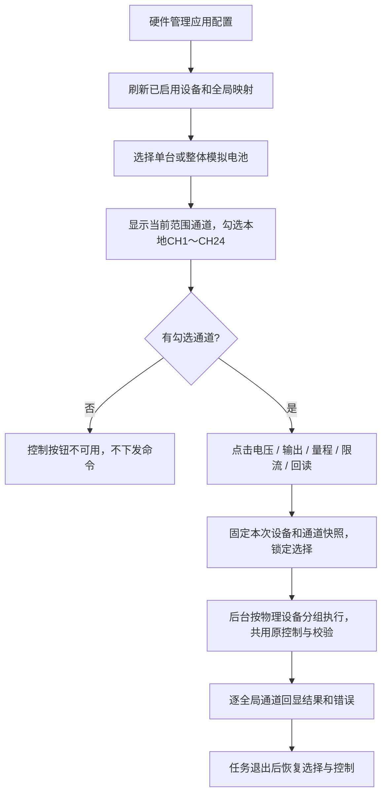
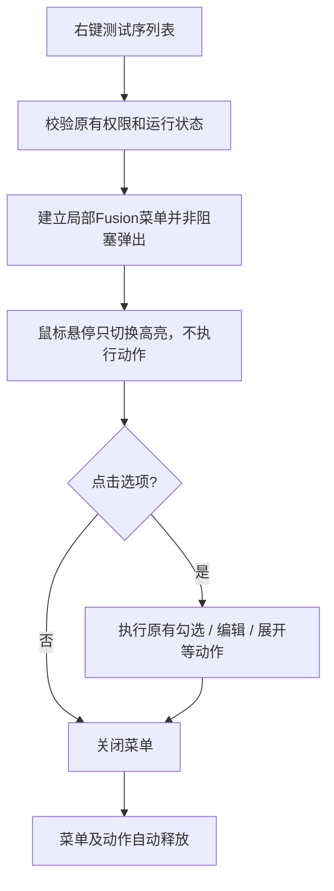

# 模拟器紧凑控制页与测试序列菜单

## 已确认范围

- 设备下拉框只列硬件管理中已启用的模拟电池，另有“整体模拟电池”。
- 单台模式仅控制该台勾选通道；整体模式中，CH1～CH24复选框分别作用于各台同号本地通道，不足24路的设备仅包含实际通道。
- 全选为真时勾选当前范围全部可用本地通道，为假时全部取消；没有勾选通道不发送命令。
- 页面采用左右两列：左侧通道表从顶部铺满整列；右侧固定宽度控制区集中放置设备选择、24路通道勾选、电压、量程、限流、输出和回读，各功能以横线分隔。
- 电压、量程、限流各自的输入和设置按钮放在同一行；按钮按内容取尺寸。右侧内容在低矮窗口中独立滚动，不挤占通道表高度；左侧保留全局通道映射及实测电压、电流。在1280×800窗口中验证24路完整可见。
- 模拟器页内不再有运行控制、硬件配置和量程限流三个选项卡；硬件配置仍由主界面的硬件管理中心负责。

量程沿用三档和限流约束：LOW固定1mA；HIGH/AUTO可编辑0～1000mA。AUTO仍需设置输出限流。

## 右键菜单

用户确认卡顿出现在鼠标切换菜单高亮时。测试页和配方序列编辑页的右键菜单局部改用Fusion绘制、去除原生窗口阴影，采用非阻塞弹出；不修改应用其他页面样式和执行逻辑。菜单关闭后自动释放，动作由菜单持有，避免重复打开时累积。

## 左右两列布局验证（2026-10-24）

- 左侧通道表占满整列高度，右侧控制区固定320逻辑像素宽度。24路勾选框按4列×6行排列；电压、量程、限流分别与其设置按钮同行，设备/通道/参数/输出/回读之间使用分割线。
- 1280×800窗口中，通道表顶部为8逻辑像素、表高784，单台24路完整可见；800×650中表高634，可完整看到21路，其余滚动查看。右侧低矮窗口独立滚动。
- 100%、150%、200%缩放下的上述两种窗口均通过实际样式和字体预览检查。量程单位、限流数值完整显示，按钮最大宽96逻辑像素。
- 相关界面、通道隔离、量程约束、配置同步与后台响应测试57项及4个子测试通过；本次仅调整布局，未连接真实硬件或打包EXE。

## 分组布局调整验证（2026-10-24，左右两列调整前）

- 电压、量程、限流及其设置按钮共用同一网格行，三个参数组以竖线区分；下方输出和回读操作以横线与参数区分开。按钮仍按内容取宽，控制区增加内边距和组间距。
- 相关界面、通道选择、量程约束、配置同步和后台响应测试57项通过，另有4个子测试通过。
- 应用实际样式及字体时，1280×800窗口通道表顶部为259逻辑像素、表高501，可完整看到约16路；800×650时顶部287、表高323，可完整看到约10路。输入与设置按钮对齐，按钮最大宽116逻辑像素。
- 本次仅调整排列，未修改硬件协议、控制范围或配置；未打包EXE。

## 首版离线验证（2026-10-24，分组布局调整前）

- 与本次变更相关的两组测试共220项通过，另有4个子测试通过；覆盖设备/通道隔离、全部/部分选择、配置刷新、LOW/AUTO、后台响应、读数保留、菜单动作和资源释放。
- 独立运行滚动定位测试为23项通过、2项失败。失败项 `test_twenty_visible_rows_advance_one_row_at_a_time_after_follow_position` 和 `test_follow_position_adapts_to_actual_viewport_height` 在本次修改前后均失败，未纳入本次修复范围。
- 使用应用样式和实际字体检查100%、150%、200%缩放下的1280×800及800×650布局，无横向溢出。1280×800时通道表顶部为186逻辑像素、表高574逻辑像素，可直接看到约19路；按钮最大宽112逻辑像素。800×650时表格顶部214、表高396，可看到约13路。
- 本地Qt离屏环境下，实际样式菜单连续切换180次高亮：中位耗时0.096ms，95分位0.161ms，最大0.775ms；没有误触发动作。该结果仅说明本地绘制表现，不能替代现场RDP验收。
- 源码编译检查及允许Windows CRLF行尾的差异空白检查通过（`git -c core.whitespace=blank-at-eol,blank-at-eof,space-before-tab,cr-at-eol diff --check`）。本次未连接真实硬件、未验证现场远程桌面、未打包EXE。

预览脚本：`tests/check_simulator_layout.py`，默认输出到 `scratch/`；可用 `SIMULATOR_PREVIEW_DIR` 指定目录。
