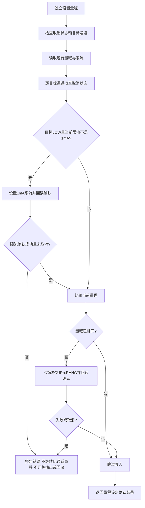

# 独立量程控制：LOW自动先设1mA限流

范围：独立“设置指定通道量程”工步、调试页“设置量程”及旧式仅包含Range的操作共用此行为。快捷配置仍执行其明确填写的电压、限流和输出参数；正常停止/异常终止整轮测试的统一关断规则不在本次变更范围。

- 独立量程操作切LOW时，若所选通道当前限流不是1mA，先发送OUTCURR限流写命令并确认，再写RANG切LOW；已经为1mA时跳过限流写入。已经在LOW但限流不正确时也会修正为1mA。
- HIGH/AUTO不主动改限流。所有独立量程操作均不发送OUTP开关或VOLT电压写命令，也不做需要联动关断的输出电压确认。限流设置失败或其后取消时，不继续此通道量程，不自动回滚已经确认的设置。
- 量程回读相符仅表示设定值已写入。N83624操作手册5.2.1节说明换档后需要再次ON生效；本次空载实测确认量程设定可以回读，未观察到输出状态变化，但尚未验证实际测量量程立即生效，也不能排除短暂电压跌落。
- 软件不主动改限流也不能保证设备其他参数不变：三台设备均在输出OFF、HIGH切AUTO时，将限流回读从1mA改为1000mA。AUTO操作仍不自动补写限流；准备开启输出时应核对限流。
- 手册：https://www.et-system.de/fileadmin/user_upload/website/Manual/DC/Manual_N83624_Battery_simulator.pdf
- 若要求不中断被测物供电，宜在供电前配置量程，或在供电前选择AUTO并保持；本次不自动更改现有配方。

## 前一版仅写量程的离线验证（2026-10-24）

- 修改前关联基线56项通过；修改后相关回归153项及172个子测试通过，正常退出。
- SCPI写入替身验证三档独立量程仅写RANG，未选通道不写；相同量程无写入；LOW限流不符合时写入前拒绝；取消及写入失败均不由量程操作追加输出开关或限流写入。
- 保留快捷配置及其原有关闭/设定/恢复策略的回归，未修改其显式参数执行逻辑。独立量程提示和调试页说明同步更新。
- 此离线阶段编译及允许Windows CRLF行尾的差异空白检查通过；当时尚未连接硬件验证带电换档。未打包EXE、未修改实际配方、未提交或推送。

## 前一版仅写量程的空载硬件实测（2026-10-24）

- 用户确认192.168.1.110、111、112三台全部空载。每台仅操作CH24，在原有3.6V、1mA限流条件下，分别覆盖OFF和ON状态的六种量程转换，共36次，其中18次带电换档。
- 36次量程设定回读正确，输出开关状态及电压设定保持不变；18次ON测试共360个设备电压回读样本，范围3.59996～3.60663V。换档阶段的写指令全部为SOUR24:RANG，没有输出开关、限流或电压写指令。
- 33次限流回读保持1mA；三台各有一次OFF状态HIGH切AUTO后，限流回读持续为1000mA，观察约1秒。不能把36次测试描述为全部参数不变。
- 测后恢复原参数，并重新连接独立核对全部72路：均为OFF，电压、限流和量程与测试前一致。仅通过源码接口测试，尚未打包EXE。
- 完整方法、逐台结果、原始日志及证据局限见[实测报告](../audits/模拟器仅切量程实测_20261024.md)。

## LOW自动限流更新验证（2026-10-24，当前版本）

- 用户要求切LOW时自动先设置1mA。新行为覆盖独立测试工步、旧式仅Range工步、调试页以及整套设备的独立量程操作，共用驱动入口；现有配方无需增加前置限流工步。
- 修改前关联基线124项及172个子测试通过。新增测试先复现旧行为拒绝执行；修改后关联回归161项及172个子测试通过，正常退出。覆盖先确认限流再切量程、已有1mA跳过写入、已有LOW修正限流、未选通道不变、HIGH/AUTO不写限流，以及限流确认失败/取消不继续量程或开关输出。
- 三台空载设备各仅使用CH24，原有3.6V。每台分别在OFF和ON状态从HIGH、AUTO及100mA限流切LOW，共12次，含6次ON。每次写入顺序均为`SOUR24:OUTCURR 1`、`SOUR24:RANG 2`；随后约1秒观察中量程为LOW、限流回读1mA，开关状态及电压设定保持不变。
- ON观察共120组设备自身回读，电压范围3.59996～3.60020V；未使用外部仪器验证瞬态或实际量程精度，不能据此保证无瞬时跌落。
- 测后恢复原参数并重新连接核对，72路均OFF且参数与测试前一致。[本次汇总](../../logs/simulator_low_auto_limit_20261024_175454/summary.json)、[恢复后独立复核](../../logs/simulator_low_auto_limit_20261024_175454/final_verified.json)。未打包EXE、未提交或推送。
