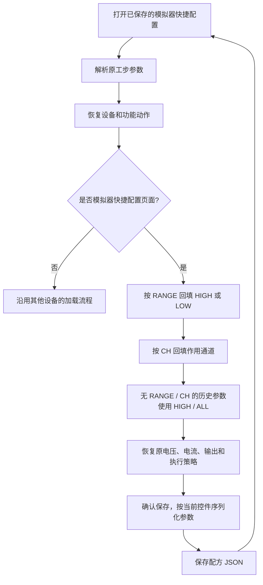
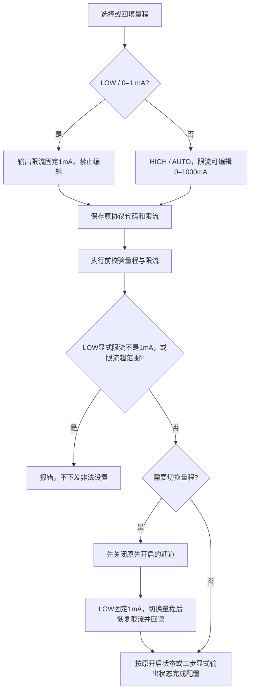

# 模拟器快捷配置量程与作用通道回填

问题：快捷配置保存了 `Range:LOW / CH:...`，但工步编辑器重新加载时未回填这两个控件，仍显示默认 HIGH / ALL。再次确认保存会覆盖原参数。

兼容当前“快捷配置”和历史“快捷批量配置”动作名称，保留原SCPI协议代码；限流约束按下节的设备规则执行。

## 三档量程与固定限流规则

量程控件显示 `0–1 mA`、`0–1000 mA`、`AUTO`，配方仍保存原协议代码 `LOW`、`HIGH`、`AUTO`。

- LOW未单独提供限流时，运行配置补充1mA；显式提供其他限流值则拒绝执行。
- 在工步编辑器打开旧LOW参数时，限流控件统一显示并保存固定1mA；不批量修改现有配方文件。
- 快捷配置设置LOW时将目标限流设为1mA；独立设置量程切LOW时也会先自动设置并确认1mA限流，再切量程，不主动开关输出或修改电压。HIGH/AUTO不主动改限流，详见[独立量程操作](simulator_range_only.md)。
- 电流读取仍返回实际测量值；固定1mA的是输出限流设置。
- 该规则相关验证共176项测试、83个子测试通过，覆盖三档保存回填、LOW固定限流、超范围拒绝、量程切换时的输出状态与电流读取。未连接硬件，未重新打包EXE。

回归包含：选择 LOW 后写入配方 JSON、重新读取并打开工步、再次保存参数不变；历史动作回填；复用编辑器时 HIGH / LOW 切换及缺省值恢复。

2026-10-24：新增的两个回归用例在修复前均复现 LOW 显示为 HIGH；修复后编辑器、模拟器配置和历史工步相关验证共 90 项测试、83 个子测试通过。未连接硬件，未重新打包 EXE。
